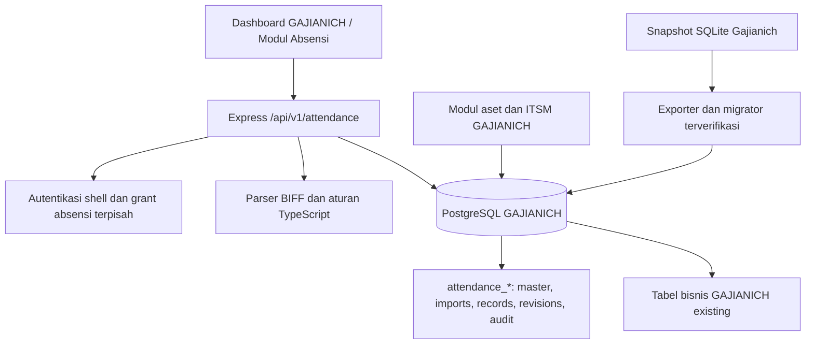

# Spesifikasi migrasi Gajianich menjadi modul Absensi GAJIANICH

Tanggal: 25 September 2026. Status: rancangan untuk implementasi, belum diterapkan.

## 1. Ringkasan dan keputusan

Pengguna meminta Gajianich disatukan dengan GAJIANICH dengan mengikuti konsep, layout, dan rules GAJIANICH. Pengguna sudah menetapkan bahwa absensi cukup digunakan melalui web/server GAJIANICH; kemampuan offline desktop tidak diperlukan.

Target: fitur absensi menjadi bagian dari Next.js dan Express GAJIANICH. PostgreSQL boleh memakai database yang sama, tetapi seluruh data bisnis absensi berada pada tabel terpisah berawalan `attendance_`. Master karyawan absensi tidak memakai master karyawan GAJIANICH. Yang digunakan ulang adalah shell aplikasi, navigasi, komponen UI, API client, dan proses deployment.

**Koreksi scope dari pengguna:** hanya aplikasinya yang menjadi satu; data absensi masih individual dan belum menyatu dengan data GAJIANICH. Instruksi ini menggantikan rekomendasi awal tentang satu master karyawan bersama. Tidak boleh membuat FK, join, sinkronisasi, lookup nama/kode, atau write dari domain absensi ke tabel bisnis GAJIANICH.

Pengguna mengonfirmasi **login GAJIANICH yang sama; data bisnis terpisah**. Akun GAJIANICH digunakan untuk autentikasi shell, sedangkan grant/role absensi dan snapshot actor disimpan di tabel absensi sendiri tanpa FK ke users GAJIANICH. Tidak membuat akun atau password absensi kedua.

**Penegasan pengguna setelah meninjau referensi tampilan, 25 September 2026:** modul hanya menangani attendance. Rekap utama menghitung **total durasi keterlambatan per karyawan** dan **total durasi lembur per karyawan** untuk periode terpilih. Tidak ada kalkulasi potongan akibat ketidakhadiran, denda keterlambatan, nominal upah lembur, atau menu Absence deduction. Status ketidakhadiran tetap dicatat sebagai data absensi.

Referensi visual terbaru adalah gambar pengguna `docs/WhatsApp Image 2026-09-25 at 1.58.18 PM.jpeg`: halaman Data Absensi dengan filter tanggal, pencarian karyawan, ringkasan horizontal, tabel jadwal/scan per karyawan, menu impor, dan aksi per baris. Referensi ini mengarahkan susunan halaman; definisi perhitungan tetap mengikuti aturan Gajianich di bagian 6. Rincian desain Data Absensi, sumber shift/jadwal, dan penguncian periode perlu diselaraskan dengan schema/API/route sebelum implementasi halaman tersebut; gambar sendiri tidak menetapkan mekanisme backend fitur-fitur itu.

Keputusan teknis usulan dalam dokumen ini:

- Port aturan absensi Rust ke TypeScript secara bertahap, dengan tes kesetaraan hasil.
- Rust core menjadi pembanding perilaku selama migrasi; tidak menjadi service produksi tambahan.
- Pertahankan identitas visual dashboard GAJIANICH yang diterapkan saat ini melalui page override terdokumentasi.
- Pakai namespace `/api/v1/attendance` dan `/dashboard/attendance`.
- Master karyawan, departemen, lokasi, identitas mesin, audit dan seluruh histori memakai tabel `attendance_*`; tidak menggunakan tabel `employees`, `departments`, `locations`, `audit_logs`, atau `asset_custodians` GAJIANICH.
- Riwayat sumber dipertahankan. Perbedaan antara perilaku lama dan perbaikan integritas dicatat sebagai perubahan yang disengaja.

Dokumen sumber [product brief](../../../../gajianich/docs/product/product-brief.md) dan [PRD](../../../../gajianich/docs/product/prd.md) memuat aturan D-01–D-11. Aturan perhitungan tersebut tetap berlaku. Keputusan web/server pada sesi ini menggantikan asumsi offline/satu operator dan kebutuhan installer desktop, bukan menghapus aturan absensi. Detail akses, batas API, dan tata letak tambahan di dokumen ini merupakan usulan target, bukan klaim persetujuan bisnis yang sudah ada.

### Tujuan

1. HR dapat mengunggah, memeriksa, mengoreksi, menyimpan, dan melaporkan absensi dari browser.
2. Identitas karyawan absensi berdiri sendiri. Nama, email, dan kode yang kebetulan sama dengan karyawan GAJIANICH tidak membentuk hubungan data.
3. Impor dan koreksi dapat ditelusuri sampai data sumber, versi aturan, alasan, dan pengguna yang melakukan aksi.
4. Beberapa pengguna dapat bekerja tanpa menimpa perubahan diam-diam.
5. Modul baru mengikuti shell dashboard, pola komponen, aturan responsif, dan pipeline GAJIANICH.

### Di luar scope

Payroll, slip gaji, perhitungan pajak/BPJS, potongan akibat ketidakhadiran, denda keterlambatan, menu Absence deduction, perhitungan nominal lembur, sinkronisasi offline, aplikasi desktop baru, sinkronisasi langsung mesin fingerprint, multi-shift per hari, kalender kerja otomatis, integrasi identitas dengan karyawan/aset GAJIANICH, serta redesign modul GAJIANICH lainnya.

Status izin/sakit/cuti adalah pencatatan absensi, bukan workflow pengajuan cuti baru. Tidak menyimpulkan alpha dari tanggal kosong tanpa kalender kerja yang sah.

## 2. Sumber aturan dan penanganan perbedaannya

Path link berikut mengarah ke checkout GAJIANICH yang diperiksa. Rules harus dibaca ulang pada awal implementasi.

| Sumber | Konsekuensi untuk migrasi |
|---|---|
| [GEMINI.md](../../../GEMINI.md) | Mengikuti SDD, kualitas kode, security, dan verifikasi. |
| [SDD](../../../.agents/rules/spec-driven-development.md) | Spec dan plan mendahului perubahan produk; implementasi mengikuti hasil review dokumen. |
| [Code quality](../../../.agents/rules/code-quality.md) | TypeScript eksplisit, tanpa `any`, nullability jelas, komponen client hanya jika perlu, feedback async, timeout fetch. |
| [Security](../../../.agents/rules/security.md) | Otorisasi di backend, validasi payload, SQL berparameter, transaksi untuk perubahan berantai. |
| [Design quality](../../../.agents/rules/design-quality.md) | Modal berbasis viewport dinamis, footer tetap terlihat, target sentuh minimal 40 px, tabel responsif. |
| [Verification](../../../.agents/rules/verification.md) | Typecheck, lint, tes backend, serta pemeriksaan desktop/mobile. |
| [Git workflow](../../../.agents/rules/git-workflow.md) dan `~/.agents/rules/git-workflow.md` | Milestone implementasi diverifikasi lalu di-commit; tidak menyertakan file pengguna yang tidak terkait. |
| [Backend AGENTS](../../../backend/AGENTS.md) | Jalankan perintah backend dari direktori backend. |
| [Frontend AGENTS](../../../frontend/AGENTS.md) | Jalankan perintah frontend dari direktori frontend; periksa dokumentasi Next.js lokal untuk API spesifik versi. |
| [Design master](../../../design-system/gajianich-itsm/MASTER.md) | Page override mengungguli master; gunakan mekanisme ini untuk menyelaraskan aturan dengan dashboard nyata. |
| [Frontend handoff](../plans/2026-09-22-frontend-page-refactor-handoff.md) | Halaman mengatur komposisi; komponen fitur, hook, dan helper memiliki batas tanggung jawab jelas. |
| [Development runbook](../../operations/development.md) | Migrasi Drizzle berbasis journal; dilarang memakai `db:push`. |

### Konflik visual yang sudah ditemukan

Master visual lama menyebut tema gelap-hijau dan Fira. `frontend/src/app/globals.css` serta halaman dashboard memakai terang-merah, Plus Jakarta Sans, dan JetBrains Mono. Root layout masih mengandung kelas gelap serta variabel font Geist. Karena ada ketidakkonsistenan, dokumen tidak mengklaim seluruh GAJIANICH sudah memakai token yang seragam.

Saat implementasi, buat `design-system/pages/attendance.md` sebagai pedoman bersama modul dan page override `attendance-imports.md`, `attendance-import-review.md`, `attendance-employee.md`, `attendance-reports.md`, `attendance-identities.md`, `attendance-master-employees.md`, `attendance-master-departments.md`, `attendance-master-locations.md`, dan `attendance-access.md` yang merujuk pedoman tersebut. Tetapkan warna, font, dan shell berdasarkan dashboard saat ini; jangan menambahkan tema gelap-hijau baru pada absensi. Tidak mengubah tema global atau root layout dalam migrasi ini.

Komponen `ModalShell` existing belum sepenuhnya memenuhi kelas viewport pada design-quality. Rencanakan penyesuaian kompatibel pada primitive bersama dan uji pemakai existing, bukan menyalin modal yang tidak sesuai ke modul baru.

## 3. Baseline kode dan batas verifikasi

| Bagian | Kondisi saat diperiksa |
|---|---|
| Gajianich | React/Vite/Tauri; SQLite dan logika domain Rust di `crates/core`. |
| Impor | Parser raw binary BIFF mesin absensi, bukan pembaca Excel umum. Limit ukuran 20 MiB. Konstanta 50.000 baris ada, tetapi penegakannya perlu diwujudkan di target. |
| UI | `src/App.tsx` 5.106 baris, banyak fallback data contoh tanpa Tauri. |
| Kontrak | Field kandidat dan draft UI berbeda dengan core; command Tauri memanggil field/fungsi yang tidak sesuai core. Jangan menyalin kontrak UI lama sebagai API baru. |
| Commit | Transaksi SQLite tersedia; identitas yang tidak ditemukan dapat dibuat otomatis. Target mengganti perilaku ini dengan pemetaan wajib. |
| GAJIANICH | Next.js 16.2.12, React 19.2.4, Tailwind 4; Express/TypeScript, PostgreSQL/Drizzle; login JWT. Versi ini baseline, bukan permintaan upgrade. |
| Karyawan GAJIANICH | ID bigint mode number, employeeCode dan email wajib unik. Hanya referensi pola implementasi; data dan constraint master ini tidak diwariskan ke karyawan absensi. |
| Custodian | Entitas pemegang aset GAJIANICH. Tidak dibaca atau diubah oleh modul absensi. |
| Audit GAJIANICH | Tidak digunakan untuk event absensi. Modul memiliki `attendance_audit_logs` sendiri. |

Verifikasi pada sesi analisis: 52 tes core Rust lulus, build frontend Gajianich lulus, build backend GAJIANICH lulus. `cargo check -p gajianich --offline` terhenti karena `pkg-config` tidak tersedia. Belum ada verifikasi UI end-to-end atau database operasional GAJIANICH. Hasil ini bukan bukti bahwa implementasi migrasi sudah berjalan.

## 4. Arsitektur dan terminologi



| Istilah | Arti |
|---|---|
| Source | Namespace mesin atau dataset penghasil nomor absensi. |
| External number | Nomor mesin sebagai teks; `001` berbeda dari `1`. |
| Batch | Satu unggahan file atau batch historis yang dimigrasikan. |
| Import row | Data mentah immutable beserta proposal dan keputusan review tersimpan. |
| Review status | `READY`, `NEEDS_REVIEW`, `BLOCKED`, `SKIPPED`; berbeda dari status kehadiran. |
| Record | Absensi efektif untuk pasangan karyawan dan tanggal. |
| Revision | Snapshot sebelum/sesudah koreksi record beserta alasan dan pelaku. |
| Legacy ID | ID sumber yang disimpan terpisah dari ID PostgreSQL tujuan. |

Alur utama: upload → parsing → pemetaan identitas → normalisasi → review → commit → laporan. Parsing tidak membuat karyawan, absensi final, atau mengubah hubungan aset. Semua keputusan review persisten di server agar refresh browser tidak menghilangkan pekerjaan.

Kedua kelompok tabel berbagi server/database, bukan entitas bisnis. Seluruh FK tabel absensi hanya boleh menunjuk tabel `attendance_*`. Service absensi tidak mengimpor schema employees/master/assets/system GAJIANICH. Nomor ID yang sama pada dua kelompok tabel tidak mempunyai hubungan. Backup fisik satu database tetap dapat memuat kedua domain; isolasi tabel bukan klaim isolasi infrastruktur atau backup independen.

## 5. Model data dan migrasi schema

Semua tabel baru memakai bigint identity sebagai PK, kecuali dinyatakan lain. API menerima ID positive safe integer sesuai pola GAJIANICH. Tanggal kerja memakai PostgreSQL `date`; jam scan memakai `time without time zone`; timestamp operasional memakai `timestamptz`. API mengirim tanggal `YYYY-MM-DD`, jam `HH:MM`, dan timestamp ISO UTC. Presentasi waktu audit menggunakan Asia/Jakarta.

### Tabel baru di `backend/src/db/schema/attendance.ts`

| Tabel | Kolom dan constraint utama |
|---|---|
| `attendance_departments` | `code` nullable unique, `name` nonempty, `is_active`, timestamps. Master departemen khusus absensi. |
| `attendance_locations` | `code` nullable unique, `name` nonempty, `is_active`, timestamps. Master lokasi khusus absensi. |
| `attendance_employees` | `employee_code` nullable unique, `full_name` wajib, `email` nullable, `phone` nullable, `department_id` FK attendance_departments RESTRICT nullable, `location_id` FK attendance_locations RESTRICT nullable, `position` nullable, `is_active`, `revision`, timestamps. Email bukan kunci identitas dan tidak wajib unik; nomor mesin dikelola di identities. |
| `attendance_sources` | `code` unique, `name`, `timezone` default `Asia/Jakarta`, `is_active`, timestamps. Satu source awal `GAJIANICH`; bukan source otomatis per nama file. |
| `attendance_employee_identities` | `employee_id` FK attendance_employees RESTRICT, `source_id` FK attendance_sources RESTRICT, `external_no_id` text nonempty, `revision` default 1, `created_by_actor` jsonb, timestamps. UNIQUE(source_id, external_no_id). Satu karyawan boleh memiliki beberapa nomor. |
| `attendance_access_grants` | `principal_key` text unique, `role` (`HR_ADMIN`, `HR_STAFF`, `REPORT_VIEWER`), `is_active`, `revision`, actor snapshot, timestamps. Tidak ada FK ke users/roles GAJIANICH. |
| `attendance_import_batches` | `source_id` FK attendance_sources, `filename`, `file_sha256` nullable untuk legacy tanpa hash sah, `original_file` bytea nullable untuk batch legacy tanpa file, `status`, `total_rows`, `rule_version`, `rule_snapshot` jsonb nullable jika legacy tidak menyimpan konfigurasi, `revision`, `created_by_actor` jsonb, `committed_by_actor` jsonb, `committed_at`, `receipt` jsonb, `commit_key`, `commit_request_hash`, timestamps. UNIQUE(source_id, file_sha256) untuk hash nyata yang tersedia. |
| `attendance_import_rows` | `batch_id` FK attendance_import_batches, `row_number`, `external_no_id`, `employee_id` FK attendance_employees nullable sebelum mapping, `identity_revision`, `work_date`, `raw_payload` jsonb immutable, `proposed_values` jsonb, `final_values` jsonb, `review_status`, `origin_tag`, `issues` jsonb, `conflict_group` text nullable, `resolution` jsonb nullable, `acknowledged_by_actor` jsonb, `acknowledged_at`, `reason`, `revision`. UNIQUE(batch_id, row_number). |
| `attendance_records` | `employee_id` FK attendance_employees RESTRICT, `work_date`, `scan_in/out` nullable, `late_minutes`, `early_minutes`, `overtime_minutes`, `attendance_status`, `source_batch_id` nullable FK attendance_import_batches, `revision_number`, timestamps. UNIQUE(employee_id, work_date). Durasi integer >= 0; revisi >= 1. |
| `attendance_revisions` | `record_id` FK attendance_records RESTRICT, `revision_number`, `before_values` jsonb nullable untuk penciptaan, `after_values` jsonb, `reason` nonempty, `actor_snapshot` jsonb nullable untuk legacy, `legacy_actor` nullable, `created_at`. UNIQUE(record_id, revision_number). |
| `attendance_audit_logs` | `actor_snapshot` jsonb, `action`, `entity_type`, `entity_id`, `before_values`/`after_values` jsonb nullable, `reason` nullable, `created_at`. Append-only melalui service; ID entitas polimorfik hanya merujuk domain attendance. |
| `attendance_migration_runs` | `dataset_sha256` unique, `mapping_sha256`, `manifest` jsonb, `status` (`COMPLETED`), `reconciliation` jsonb, `executed_by_actor` jsonb, timestamps. Dry-run tidak menulis tabel ini. |
| `attendance_legacy_entities` | `dataset_sha256`, `entity_type`, `legacy_id`, `target_entity_type` nullable, `target_id` nullable, `original_payload` jsonb, `migration_run_id` FK. UNIQUE(dataset_sha256, entity_type, legacy_id). Menyimpan pemetaan dan bukti historis termasuk audit lama. |

`target_id` pada arsip bersifat polimorfik dan tidak mempunyai FK generik; migrator memvalidasi target menurut `target_entity_type` dalam transaksi. FK konkret tabel operasional tetap wajib.

Index tambahan: records(work_date, employee_id), batches(created_at), rows(batch_id, review_status, row_number), revisions(record_id, created_at). Status batch dibatasi `DRAFT`, `COMMITTED`, `CANCELLED`. Kasus parse gagal mengembalikan error tanpa menyisakan batch parsial. Batch cancelled tetap dapat dilihat; upload file yang sama mengembalikan batch tersebut, lalu HRAdmin dapat membuka ulang melalui endpoint reopen dengan audit.

`rule_snapshot` memuat konfigurasi normalisasi lengkap. Perubahan versi aturan tidak menghitung ulang data final yang sudah disimpan. Tidak memerlukan editor aturan umum pada rilis pertama.

Batch baru wajib memiliki hash, file asli, dan rule snapshot. Batch historis yang tidak memiliki metadata lengkap memakai null dan penanda legacy melalui arsip, bukan nilai yang ditebak. Jika beberapa batch legacy mempunyai hash sama, petakan ke satu batch kanonis sambil mengarsipkan seluruh batch sumber; relokasi row_number harus deterministik dengan nomor asli tersimpan pada raw_payload dan legacy map. Jangan membuang baris karena benturan nomor baris.

File asli disimpan di PostgreSQL agar tidak hilang ketika container dibuat ulang dan ikut backup GAJIANICH. Hash dihitung dari bytes server, bukan nilai kiriman UI. Rilis pertama tidak menyediakan penghapusan otomatis file/bukti; pantau ukuran backup. Limit 20 MiB per file tetap berlaku. Tidak mengirim bytes file dalam response daftar/detail batch.

### Batas perubahan existing

- Tidak menambah kolom/FK atau mengubah data pada tabel bisnis GAJIANICH, termasuk employees, departments, locations, asset_custodians dan audit_logs.
- Tidak menambahkan role HR pada tabel roles/users GAJIANICH. Izin modul berada di attendance_access_grants; akun tanpa grant aktif tidak memperoleh akses data absensi.
- Tidak mengubah employee routes/controller/table UI GAJIANICH. Master absensi memakai endpoint dan halaman tersendiri.
- Kode shell, API client, primitive UI, registrasi route, dan build pipeline boleh diperluas untuk menampilkan modul baru secara kompatibel.
- Actor snapshot memuat `principalKey`, `displayName`, dan `roleAtAction` dari server pada waktu aksi; tidak menjadi relasi FK ke GAJIANICH. Tidak menyalin password atau token ke tabel absensi.
- Penghapusan master absensi dilakukan dengan nonaktifkan; tidak ada endpoint hard-delete rutin. FK internal menjaga histori.

Migration SQL dan snapshot/journal dihasilkan dengan `npm run db:generate` dari backend. Nomor file mengikuti journal aktual; jangan mengasumsikan nomor berikutnya. Review output dan keluarkan perubahan tabel bisnis existing yang tidak terkait, termasuk drift schema yang mungkin ikut terdeteksi generator. Terapkan dengan `npm run db:migrate`. Tidak menggunakan `db:push` atau seed sebagai pengganti migrasi.

## 6. Aturan identitas dan integritas

### Pemetaan karyawan

1. Cocokkan `(sourceId, externalNoId)` ke tabel identity.
2. Tampilkan nama sumber dan nama GAJIANICH untuk review jika berbeda; jangan ubah nama master otomatis.
3. Nomor belum dipetakan menahan commit baris yang akan menghasilkan kehadiran. Baris skipped tetap disimpan sebagai bukti.
4. Kandidat nama/kode hanya saran dari master **attendance_employees**. HRAdmin menetapkan pemetaan atau membuat karyawan melalui form Master Karyawan Absensi. Email dan kode internal opsional; nomor mesin tetap wajib pada identity. Jangan membaca atau menawarkan karyawan GAJIANICH sebagai kandidat.
5. Karyawan inactive masih dapat menerima impor historis dengan konfirmasi HRAdmin dan alasan; jangan aktifkan kembali karyawan otomatis.
6. Pemetaan yang sudah dipakai record final tidak dapat dialihkan ke orang lain pada rilis pertama. Koreksi salah pemetaan diselesaikan sebagai rekonsiliasi terkontrol, bukan update massal tersembunyi.
7. Saat commit, periksa ulang identity revision dan target karyawan; pemetaan yang berubah sejak review menghasilkan 409.

### Normalisasi dan status

- Kedua scan ada: pertahankan nilai valid dari sumber.
- Hanya scan masuk kosong: isi dari Jam Masuk, tetap hadir, nolkan **hanya terlambat**; lembur dan pulang cepat tetap mengikuti sumber. Tandai `NEEDS_REVIEW` dan minta acknowledgment.
- Hanya scan pulang kosong: isi dari Jam Pulang, tetap hadir, nolkan **hanya pulang cepat**; lembur dan terlambat tetap mengikuti sumber. Tandai `NEEDS_REVIEW` dan minta acknowledgment.
- Kedua scan kosong: `SKIPPED`, tidak menghasilkan record `PRESENT` atau `ALPHA` otomatis.
- Durasi adalah menit integer nonnegatif; `25:00` menjadi 1500 menit, bukan jam kalender.
- Durasi berasal dari kolom `Lembur`, `Terlambat`, dan `Plg. Cepat`; jangan menghitung ulang dari selisih scan. Kolom `Lembur Hari Normal`, `Lembur Akhir Pekan`, `Lembur Hari Libur`, `Normal`, dan `Riil` tidak dijumlahkan sebagai tiga kategori tersebut. Sel kosong boleh menjadi nol jika kolomnya ada; kolom wajib hilang memblokir impor.
- Nilai durasi rusak, tanggal tidak sah, scan tidak sah, dan file terpotong tidak diubah diam-diam menjadi nol. Tampilkan issue dan blokir baris/file sesuai tingkat kesalahan.
- Koreksi manual membutuhkan alasan; edit membatalkan acknowledgment lama dan menambah revisi draft. Tanggal efektif dan keputusan include/skip dapat dikoreksi tanpa mengubah raw; setiap perubahan tanggal memvalidasi ulang konflik. Mengubah scan tidak menghitung ulang durasi dan normalisasi ulang tidak menimpa override HR.
- Status kehadiran: `PRESENT`, `IZIN`, `SAKIT`, `CUTI`, `ALPHA`, `UNSPECIFIED`. `NO_DATA` hanya hasil query kartu, tidak disimpan sebagai record kehadiran.
- Scan nonhadir harus null dan durasinya nol. Histori nilai sebelumnya tetap ada di revisions.
- Satu record per karyawan per tanggal. Kasus lintas tengah malam/multi-shift yang tidak dapat direpresentasikan harus tampil sebagai issue untuk review; tidak menebak durasi dari pengurangan jam.

### Duplikasi dan transaksi

- File sama dalam source yang sama mengembalikan batch existing; tidak membuat record ulang.
- Duplikasi dalam file menghasilkan grup konflik. Reviewer memilih satu kandidat; kandidat lain ditandai skipped dengan alasan dan referensi keputusan.
- Jika record final sudah ada pada employee/date, HR memilih keep-existing atau incoming. Keep-existing menyimpan incoming sebagai skipped beserta bukti. Memilih incoming menyimpan expected revision record existing dalam keputusan konflik; saat commit oleh HRAdmin, update final membuat revision before/after dan audit dengan alasan. Histori tidak dihapus dan durasi kandidat tidak dijumlahkan. Record yang berubah sesudah review menghasilkan 409 dan wajib direview ulang.
- Commit mengunci batch, memeriksa expectedRevision, identitas, keputusan review, serta record employee/date di dalam satu transaksi. Constraint unik tetap menjadi pengaman ketika batch lain berlomba.
- Audit, revision, record final, receipt, dan status batch ikut transaksi yang sama. Kegagalan salah satu membatalkan semua perubahan commit.
- `Idempotency-Key` commit disimpan beserta hash request. Retry key/payload sama mengembalikan receipt tersimpan dengan waktu commit yang sama. Key berbeda pada batch committed atau key sama dengan payload berbeda menghasilkan 409.
- Koreksi record memakai conditional update `WHERE id = ? AND revision_number = ?`; bila tidak ada baris berubah, response 409. Insert revision dan audit berada dalam transaksi yang sama.

Setiap upload, normalisasi, perubahan mapping, edit/acknowledgment, keputusan konflik, cancel/reopen, commit, koreksi, dan ekspor mencatat event audit. Mutasi data dan audit berada dalam satu transaksi. Ekspor mencatat filter, waktu pembuatan, dan versi data yang dibaca; tidak memasukkan seluruh CSV ke log. Restore database mengikuti audit operator pada runbook pemulihan GAJIANICH.

Perbedaan disengaja dari sumber: tidak auto-create employee saat commit; tidak percaya actor/status final kiriman klien; tidak mengabaikan durasi invalid; tidak mengubah data committed melalui normalisasi ulang; seluruh koreksi dan audit atomik.

## 7. Otorisasi

Gunakan autentikasi JWT GAJIANICH. Setelah token valid, adapter autentikasi memeriksa akun aktual masih aktif. Bentuk principalKey server-side sebagai `gajianich:user:<userId>`, kemudian baca grant aktif di `attendance_access_grants`. Pembacaan users untuk autentikasi adalah batas integrasi aplikasi yang diizinkan; tidak ada pembacaan master karyawan/aset GAJIANICH. `roleId` JWT tidak digunakan sebagai FK role karena login existing mengisinya dengan user ID.

Role domain absensi: `HR_ADMIN` (label HRAdmin), `HR_STAFF` (HRStaff), dan `REPORT_VIEWER` (Pembaca Laporan). Role ini tidak mengubah users.role GAJIANICH. Akun ITAdmin, Management, Employee, atau SuperAdmin hanya mendapat akses bisnis absensi jika diberi grant yang sesuai. SuperAdmin GAJIANICH boleh mengelola grant modul, tetapi membaca data bisnis tetap membutuhkan grant aktif.

| Aksi | HRAdmin | HRStaff | Pembaca Laporan | Tanpa grant aktif |
|---|:---:|:---:|:---:|:---:|
| Lihat master, detail absensi dan batch | Ya | Ya | Tidak | Tidak |
| Upload, edit draft, review | Ya | Ya | Tidak | Tidak |
| Commit dan koreksi final | Ya | Tidak | Tidak | Tidak |
| Kelola master absensi, mapping dan sumber | Ya | Tidak | Tidak | Tidak |
| Batalkan/buka ulang draft | Ya | Tidak | Tidak | Tidak |
| Rekap agregat per periode dan CSV agregat | Ya | Ya | Ya | Tidak |
| File asli, revisions dan audit detail | Ya | Ya | Tidak | Tidak |

Pembaca Laporan hanya menerima agregat tanpa nama, employeeId, nomor mesin, atau baris per-orang; parameter filter employee tidak diizinkan pada endpoint summary. Role Employee GAJIANICH tidak menjadi relasi ke attendance_employees. Tidak ada portal absensi pribadi pada rilis pertama.

`GET /me` mengembalikan permission modul aktual untuk menu/action. UI tidak menebak izin absensi dari roleName GAJIANICH. Revokasi grant berlaku pada request berikutnya; histori actor tidak hilang karena berupa snapshot. Pengelolaan grant mencatat audit absensi dan memvalidasi principal terhadap provider autentikasi; tidak membuat user baru. Jangan memasukkan grant HR ke helper `canManageCustodians` atau mengubah hak akses modul IT.

## 8. Kontrak API

Semua path relatif ke `/api/v1/attendance`. ID bertipe number safe integer positif. List menggunakan `{ items, total, page, pageSize }`, pageSize default 50 dan maksimum 100. Error memakai `{ error: string, code: string, details?: object }` agar kompatibel dengan `apiFetch` existing.

| Method/path | Request | Response sukses | Izin |
|---|---|---|---|
| GET `/me` | sesi GAJIANICH | 200 role modul nullable + permissions + canManageAccess; tanpa data karyawan | Semua sesi GAJIANICH valid |
| GET `/access-grants` | page/pageSize | 200 daftar grant | SuperAdmin GAJIANICH |
| POST `/access-grants` | principalKey, role, reason | 201 grant; validasi akun login existing | SuperAdmin GAJIANICH |
| PATCH `/access-grants/:id` | role?, isActive?, expectedRevision, reason | 200 grant | SuperAdmin GAJIANICH |
| GET `/departments` | q, page/pageSize | 200 master departemen absensi | HR read |
| POST `/departments` | code?, name | 201 departemen absensi | HRAdmin |
| PATCH `/departments/:id` | code?, name?, isActive? | 200 departemen absensi | HRAdmin |
| GET `/locations` | q, page/pageSize | 200 master lokasi absensi | HR read |
| POST `/locations` | code?, name | 201 lokasi absensi | HRAdmin |
| PATCH `/locations/:id` | code?, name?, isActive? | 200 lokasi absensi | HRAdmin |
| GET `/employees` | q, departmentId?, isActive?, page/pageSize | 200 master karyawan absensi | HR read |
| POST `/employees` | fullName, employeeCode?, email?, phone?, departmentId?, locationId?, position? | 201 karyawan absensi | HRAdmin |
| GET `/employees/:id` | ID attendance_employees | 200 detail master absensi | HR read |
| PATCH `/employees/:id` | expectedRevision, reason, field profil opsional, isActive? | 200 karyawan absensi | HRAdmin |
| GET `/sources` | page/pageSize | 200 daftar source | HR read |
| POST `/sources` | code, name, timezone | 201 source | HRAdmin |
| GET `/identities` | sourceId, q, page/pageSize | 200 daftar mapping | HR read |
| POST `/identities` | sourceId, externalNoId, employeeId, reason | 201 mapping | HRAdmin |
| PATCH `/identities/:id` | employeeId, expectedRevision, reason | 200 mapping, atau 409 bila sudah dipakai final | HRAdmin |
| POST `/imports` | multipart: file, sourceId | 201 batch baru; 200 batch existing dengan reused=true | HR write draft |
| GET `/imports` | status, date range, page/pageSize | 200 daftar batch | HR read |
| GET `/imports/:id` | ID | 200 batch + summary + revision, tanpa semua rows | HR read |
| GET `/imports/:id/file` | ID | 200 binary attachment | HR read |
| GET `/imports/:id/rows` | reviewStatus, q, page/pageSize | 200 rows | HR read |
| POST `/imports/:id/reconcile` | expectedRevision | 200 summary setelah pemetaan terbaru; invalidasi ack yang terdampak | HR write draft |
| PATCH `/imports/:id/rows/:rowId` | expectedBatchRevision, expectedRowRevision, finalValues, workDate?, disposition (`INCLUDE`/`SKIP`), reason | 200 row + batchRevision; status kesiapan dihitung server | HR write draft |
| POST `/imports/:id/rows/:rowId/acknowledge` | expectedBatchRevision, expectedRowRevision | 200 row + batchRevision | HR write draft |
| POST `/imports/:id/conflicts/resolve` | expectedRevision, conflictGroup, selectedRowId atau keepExisting=true, expectedRecordRevision jika existing, reason | 200 summary + revision | HR write draft |
| POST `/imports/:id/commit` | expectedRevision; header Idempotency-Key | 200 receipt tersimpan | HRAdmin |
| POST `/imports/:id/cancel` | expectedRevision, reason | 200 batch CANCELLED | HRAdmin |
| POST `/imports/:id/reopen` | expectedRevision, reason | 200 batch DRAFT; validasi ulang dan reset ack | HRAdmin |
| GET `/employees/:employeeId/card` | startDate, endDate | 200 employee + days + totals | HR read |
| POST `/records` | employeeId, workDate, status, scanIn/out, minutes, reason | 201 record manual; 409 jika employee/date sudah ada | HRAdmin |
| PATCH `/records/:id` | expectedRevision, status, scanIn/out, minutes, reason | 200 record revisi baru | HRAdmin |
| GET `/records/:id/revisions` | page/pageSize | 200 revisions | HR read |
| GET `/reports` | startDate, endDate, employeeId?, departmentId?, page/pageSize | 200 rekap per karyawan + totals seluruh filter | HR read |
| GET `/reports.csv` | filter sama tanpa pagination | 200 CSV seluruh filter, bukan hanya halaman aktif | HR read |
| GET `/summary` | startDate, endDate | 200 totals agregat tanpa identitas | HR read / Pembaca Laporan |
| GET `/summary.csv` | startDate, endDate | 200 CSV totals agregat | HR read / Pembaca Laporan |
| GET `/audit` | entityType?, entityId?, page/pageSize | 200 event attendance termasuk arsip legacy berlabel | HR read |

HR read = grant HR_ADMIN/HR_STAFF; HR write draft = grant yang sama. HRAdmin berarti grant HR_ADMIN, bukan users.role GAJIANICH. Seluruh employeeId/departmentId/locationId di namespace ini adalah ID tabel attendance_*, tidak pernah ID master GAJIANICH. Range tanggal inklusif, maksimum 366 hari per permintaan; rentang lebih panjang dipecah pengguna. Seluruh query reports hanya memakai record efektif, tidak menghitung draft. Filter departemen memakai departemen karyawan absensi saat ini dan diberi keterangan di UI; histori departemen tidak direkonstruksi dari asumsi.

Setiap baris rekap HR wajib memuat dua metrik utama: `lateMinutes` (total durasi keterlambatan) dan `overtimeMinutes` (total durasi lembur). Keduanya merupakan SUM menit final seluruh record efektif milik karyawan pada periode inklusif yang dipilih, bukan jumlah kejadian, bukan pengurangan jam scan, dan bukan nominal uang. Tampilkan sebagai jam dan menit, termasuk total melampaui 24 jam; 90 menit ditampilkan sebagai 1 jam 30 menit. Pagination tidak membatasi cakupan total.

Contoh penerimaan: tiga record karyawan dengan keterlambatan 15, 20, 10 menit dan lembur 60, 90, 0 menit menghasilkan total keterlambatan 45 menit dan lembur 2 jam 30 menit. Draft, baris skipped/blocked, kandidat duplikat, dan revisi lama tidak ditambahkan. Koreksi final menggantikan kontribusi nilai lama dalam rekap, bukan menambah kedua versi. Nol durasi pada record valid berbeda dari belum adanya data final; keduanya diberi konteks yang berbeda pada tampilan.

CSV menyertakan periode, employeeCode, nomor mesin/source yang relevan, nama, `lateMinutes`, `overtimeMinutes`, generatedAt dan dataVersion. Nomor mesin multipel ditampilkan sebagai daftar berlabel source, tidak menggandakan baris rekap karyawan. Data pulang cepat dari sumber tetap dipertahankan pada record/detail dan arsip untuk kesetaraan migrasi; data tersebut bukan metrik utama rekap dan tidak digunakan menghitung potongan. Pemeriksaan enam metrik menit/hari sumber pada migrasi merupakan verifikasi integritas historis, bukan penambahan kalkulasi bisnis pada halaman rekap.

`dataVersion` laporan adalah hash deterministik dari record ID/revision dan identitas tampilan/filter yang dibaca pada satu transaksi read-only REPEATABLE READ. API laporan dan ekspor membaca snapshot konsisten. Ekspor dari UI mengirim `expectedDataVersion` hasil laporan; server mengembalikan 409 `REPORT_CHANGED` jika data berubah, sehingga UI meminta muat ulang alih-alih mengunduh angka yang diam-diam berbeda.

Contoh response commit:

```json
{
  "batchId": 42,
  "status": "COMMITTED",
  "receiptId": "receipt-42",
  "committedAt": "2026-09-25T07:30:00.000Z",
  "insertedRecords": 183,
  "updatedRecords": 0,
  "skippedRows": 0,
  "revision": 8
}
```

Contoh stale edit:

```json
{
  "error": "Data berubah sejak halaman ini dibuka. Muat ulang sebelum menyimpan.",
  "code": "REVISION_CONFLICT",
  "details": { "currentRevision": 9 }
}
```

Kode: 400 payload/format/rentang salah; 401 token missing/expired atau akun tidak aktif dengan code `SESSION_INVALID`; 403 role tidak diizinkan; 404 entitas tidak ada; 409 revisi/duplikasi/pemetaan/commit conflict; 413 >20 MiB atau >50.000 baris; 415 signature file tidak didukung; 422 review belum selesai. Error internal tidak membocorkan SQL, path server, atau token.

### Transport, upload dan sesi

- Gunakan `api.upload`, `api.get`, `api.post`, `api.patch`, dan `api.download` existing. Request biasa timeout 10 detik; upload/commit/export 60 detik. Batas ini usulan yang harus diukur di staging.
- Abort setelah submit tidak berarti transaksi dibatalkan. UI menampilkan hasil belum diketahui, membaca status batch, lalu retry commit dengan key yang sama.
- Tangani 401 dan kode `SESSION_INVALID` dengan membersihkan cookie dan localStorage serta mengarahkan ke login. Jangan logout pada 403 insufficient-role atau gangguan jaringan biasa.
- Middleware autentikasi GAJIANICH saat ini memakai 403 untuk token invalid. Integrasi harus menyediakan error code sesi yang eksplisit melalui penyesuaian kompatibel pada middleware/auth dan tes caller existing; jangan menafsirkan semua 403 sebagai sesi kedaluwarsa.
- Limit upload ditegakkan pada middleware dan parser berdasarkan bytes/signature; extension dan MIME hanya informasi tambahan. Nginx existing menerima 50M, jadi limit aplikasi 20 MiB lebih ketat.
- Parser memeriksa boundary setiap BIFF record. Baris melampaui limit dan binary terpotong ditolak eksplisit. Formula tidak dieksekusi. Encoding fixture diuji sebelum mengklaim dukungan format lain.
- Batasi query dan batch insert; jangan menjalankan puluhan ribu await/SQL satu per baris. Uji dampak parsing terhadap health endpoint. Jika parsing sinkron memblokir server pada fixture batas, gunakan Node worker thread untuk parser saja, tanpa menambah service atau queue eksternal.

## 9. Layout dan pengalaman pengguna

### Integrasi shell dan navigasi

Semua halaman memakai `DashboardLayout` dan `AuthContext` existing. Jangan membawa sidebar, header desktop, global `App.css`, atau branding aplikasi kedua dari Gajianich.

Tambahkan grup sidebar **Absensi** sesudah Master Data dengan item: **Master Karyawan Absensi**, **Impor Absensi**, **Kartu Absensi**, **Laporan Absensi**, dan **Pemetaan Identitas**. Tampilkan sesuai permission `/attendance/me`; Pembaca Laporan hanya melihat Laporan Absensi yang menggunakan summary. Halaman mapping memuat pengelolaan source sederhana. Master absensi mencakup departemen/lokasi miliknya. SuperAdmin GAJIANICH melihat **Akses Absensi** untuk mengelola grant. Master karyawan GAJIANICH di `/dashboard/master/employees` tetap tidak terhubung.

| Route | Layout dan komponen fitur |
|---|---|
| `/dashboard/attendance` | Redirect ke imports untuk HR, reports untuk Pembaca Laporan; akun tanpa grant menampilkan akses ditolak. |
| `/dashboard/attendance/master/employees` | CRUD master karyawan absensi, status aktif, pencarian, tautan kartu; tidak memakai endpoint /api/v1/employees GAJIANICH. |
| `/dashboard/attendance/master/departments` | Master departemen khusus absensi. |
| `/dashboard/attendance/master/locations` | Master lokasi khusus absensi. |
| `/dashboard/attendance/access` | Pengelolaan grant absensi oleh SuperAdmin GAJIANICH; tidak mengubah role akun GAJIANICH. |
| `/dashboard/attendance/imports` | Judul + Upload; ringkasan batch nyata; filter; tabel batch; upload modal. |
| `/dashboard/attendance/imports/[id]` | Metadata batch; tahapan proses; summary review; filter status; tabel raw/proposed/final; panel konflik; audit batch; aksi commit sesuai izin. |
| `/dashboard/attendance/employees` | Pencarian/pemilih dari attendance_employees dan rentang tanggal; tautan kartu per karyawan. |
| `/dashboard/attendance/employees/[id]` | Profil ringkas dari master; kartu harian; ringkasan; modal koreksi; riwayat revisi. |
| `/dashboard/attendance/reports` | Filter periode/departemen absensi; rekap dan ekspor untuk HR; hanya ringkasan agregat untuk Pembaca Laporan. |
| `/dashboard/attendance/identities` | Pemilih source; pencarian nomor mesin/karyawan; daftar mapping; form mapping dan form source khusus HRAdmin. |

Aksi **Lihat Absensi** hanya berada pada tabel Master Karyawan Absensi. Jangan menambah tautan kartu absensi pada EmployeeTable GAJIANICH karena ID dan entitasnya berbeda. Label navigasi dan breadcrumb harus membedakan kedua master dengan jelas, walaupun komponen visualnya menggunakan pola yang sama.

Pada laporan HR, tampilkan nama/ID karyawan, periode, **Total Keterlambatan** dan **Total Lembur** sebagai informasi utama. Kedua total mengikuti filter yang sama dan dapat ditelusuri ke detail harian. Tidak ada kolom nominal, tarif, pengali pembayaran, atau potongan. Ringkasan untuk Pembaca Laporan tetap tanpa identitas sesuai batas akses bagian 7. Penyesuaian halaman utama ke referensi Data Absensi harus mempertahankan batas akses ini.

### Token dan komponen

| Elemen | Pedoman target mengikuti dashboard |
|---|---|
| Surface | Halaman slate-50 / `#F8FAFC`, panel putih, border slate-200 / `#E2E8F0`. |
| Teks | slate-900 / `#0F172A`; metadata slate-500 dengan verifikasi kontras ukuran aktual. |
| Aksi utama | red-600 / `#DC2626`, hover red-700; satu aksi utama per konteks. |
| Tipografi | Gunakan font body dan `.font-mono` existing; tidak menambah font. |
| Spasi/bentuk | `space-y-6`, header bertumpuk di mobile, panel rounded-2xl dan kontrol rounded-xl sesuai halaman GAJIANICH. |
| Ikon | `lucide-react` existing; pilih ikon absensi, unggah, file, karyawan, dan riwayat yang relevan. |
| Status | Gunakan `StatusBadge`: success untuk ready/present, danger untuk anomali scan yang dinormalisasi dan blocked dengan label berbeda, warning untuk review lainnya, slate untuk skipped/no-data; label teks selalu ada. |
| Dialog | Gunakan `ModalShell`; confirmation existing hanya untuk konfirmasi sederhana. Koreksi dengan alasan mempunyai form sendiri di dalam shell. |

Perbedaan no-data, skipped, alpha, dan izin tidak boleh ditentukan hanya dari warna. Durasi diberi satuan menit atau `jam:menit` yang jelas; jangan tampilkan angka desimal tanpa label.

Aturan D-08 dari produk sumber tetap berlaku: baris scan yang dinormalisasi mempunyai penanda merah serta teks **Data Excel tidak lengkap, sudah dinormalisasi**. Jangan mengganti penanda tersebut seluruhnya menjadi amber demi palet status umum. CTA penyimpanan di target diusulkan **Simpan Absensi** dengan penjelasan bahwa yang disimpan adalah hasil review, bukan penghitungan gaji.

### Modal dan responsif

Kelas wajib menurut rules GAJIANICH:

```text
Backdrop: fixed inset-0 z-50 flex items-center justify-center p-3 sm:p-4 bg-slate-900/60 backdrop-blur-sm overflow-hidden
Dialog: max-h-[92dvh] sm:max-h-[88vh] flex flex-col overflow-hidden
Header: shrink-0
Body: flex-1 min-h-0 overflow-y-auto overscroll-contain
Footer: shrink-0 border-t
```

Perbaikan shell mempertahankan prop API existing, menambahkan focus trap, pengembalian focus, tombol close minimal 40x40, dan title ID unik bila dibutuhkan. Verifikasi modal aset, karyawan, dan lisensi yang memakai shell setelah perubahan.

Uji 360, 375, 430, 768, 1024, dan 1440 px. Tabel >4 kolom boleh scroll horizontal di dalam panel; halaman tidak overflow. Form satu kolom di mobile. Footer simpan tetap terlihat saat keyboard/browser toolbar muncul. Target sentuh minimum 40x40 px, dianjurkan 44x44 px. Fokus keyboard terlihat, Escape aman, dan reduced-motion dihormati.

### State dan navigasi

- Loading: skeleton/spinner dengan label; tidak menampilkan angka dummy.
- Empty: bedakan belum ada batch, hasil filter kosong, dan tanggal tanpa data.
- Error: pesan dari server, tombol retry; error tidak diganti data contoh.
- Review: raw dan proposal dapat dibandingkan; alasan edit, identitas reviewer, serta versi aturan terlihat.
- Conflict: tampilkan kandidat dan konsekuensi keep-existing/skip; tombol commit menjelaskan alasan disabled.
- Success: receipt server dan tautan laporan; tidak membuat receipt lokal.
- Read-only: batch committed/cancelled tidak dapat diedit; koreksi final memakai alur tersendiri.
- Refresh/back: filter disimpan pada query string; data draft dimuat ulang dari server; edit lokal belum disimpan diberi peringatan sebelum keluar.
- Request lama tidak boleh menimpa filter/karyawan baru; cancel request lama atau abaikan hasil berdasarkan request identity.

## 10. Migrasi data historis

Gunakan snapshot SQLite konsisten dan manifest SHA-256. Jangan menyalin file `.db` aktif tanpa checkpoint/backup API karena mode WAL dapat menyimpan transaksi di file terpisah.

Pemetaan sumber:

| SQLite | PostgreSQL |
|---|---|
| employees | attendance_employees baru atau existing melalui keputusan eksplisit + attendance_employee_identities + arsip original payload. Tidak memetakan ke employees GAJIANICH. |
| import_batches | attendance_import_batches dengan legacy ID terarsip, rule metadata dipertahankan apa adanya |
| raw_attendance_records | attendance_import_rows; data asli tetap immutable |
| attendance_records | attendance_records dengan employeeId target, nilai efektif dan revisi dipertahankan |
| attendance_revisions | attendance_revisions jika dapat dipetakan tanpa mengarang snapshot; seluruh payload asli masuk attendance_legacy_entities |
| audit_logs | attendance_legacy_entities sebagai audit historis; attendance_audit_logs mencatat proses migrasi dengan snapshot akun pelaksana |

Actor lama berupa string tidak disamakan otomatis dengan akun GAJIANICH. Pakai `legacy_actor` dan label sumber. Revisi lama dengan changed-fields saja tetap ditampilkan sebagai legacy event; jangan merekayasa before/after penuh. Jika nomor revisi sudah ada tetapi payload lama tidak cukup, simpan arsipnya tanpa membuat revision modern palsu.

Migrasi menyimpan dataset hash + legacy ID map. Menjalankan dataset yang sudah completed menjadi no-op terverifikasi; dataset berbeda yang overlap pada employee/date menghasilkan konflik, bukan overwrite. Data gagal mapping dilaporkan dan menghalangi cutover. Detail operasi berada di [runbook](../../operations/gajianich-attendance-migration.md).

Pada target attendance yang kosong, keputusan `CREATE` membentuk master attendance_employees dari sumber tanpa memerlukan email/kode karyawan GAJIANICH. Departemen teks sumber dinormalisasi trim lalu dipetakan ke attendance_departments dengan keputusan yang tercatat; nama ambigu ditahan untuk HR. Location yang tidak tersedia tetap null. Keputusan `LINK` hanya menunjuk karyawan attendance existing. Karyawan bernama/kode sama pada employees GAJIANICH tidak menjadi kandidat dan tidak menghalangi migrasi.

## 11. Verifikasi dan penerimaan

1. Parser fixture nyata menghasilkan hash, jumlah baris, nomor mesin, tanggal, dan menit yang sama dengan core Rust. Fixture hilang harus membuat tes gagal, tidak skip diam-diam.
2. Fixture invalid membuktikan validasi target: nomor `001`, dua nama sama, hash sama, binary terpotong, durasi `25:00`, tanggal kabisat, scan kosong, dan batas ukuran/baris.
3. Integration test PostgreSQL membuktikan rollback penuh, unique employee/date, pilihan incoming membuat revision record existing, stale update 409, retry commit dengan receipt tetap, dan tidak ada duplikasi saat dua pengguna commit.
4. Endpoint menolak akses tanpa token, akun tanpa grant aktif, akun inactive, grant yang sudah dicabut, serta upaya mengirim actor atau keputusan server palsu. Role IT/Employee/SuperAdmin tanpa grant tidak memperoleh akses bisnis otomatis.
5. Pembaca Laporan tidak menerima identitas atau endpoint detail meskipun URL dipanggil langsung.
6. Browser menjalankan upload nyata sampai CSV; refresh review mempertahankan keputusan; timeout commit dapat dipulihkan tanpa duplikasi.
7. Rekap seluruh periode/karyawan yang dimigrasikan sama dengan sumber untuk jumlah status dan enam metrik menit/hari; perbedaan tidak boleh ditutup dengan toleransi arbitrer. Ekspor dengan versi data yang berubah ditolak 409, bukan menghasilkan angka berbeda diam-diam.
8. Existing asset/custodian/ticket/license flows dan role mereka tetap bekerja.
9. Target awal yang harus diukur: normalisasi 10.000 baris <=15 detik; rekap satu bulan dataset representatif <=3 detik di server staging. Uji batas 50.000 baris, memory, dan respons `/health/ready` bersamaan; angka ini target, bukan hasil ukur.
10. Backup PostgreSQL pascamigrasi dipulihkan ke database terpisah dan hasil rekonsiliasi diverifikasi.
11. Tidak ada FK dari attendance_* ke tabel non-attendance. Tes mengubah master/absensi dan membuktikan tabel bisnis/audit GAJIANICH tidak berubah; kode service tidak membaca master GAJIANICH. Fixture dua karyawan bernama/kode/ID numerik sama pada masing-masing domain tetap independen.
12. Rekap per karyawan dan CSV menghasilkan total keterlambatan/lembur yang sama untuk filter dan versi data yang sama. Uji contoh 45 menit terlambat/150 menit lembur, total di atas 24 jam, koreksi tanpa penghitungan ganda, pagination, serta pemisahan nol valid dari belum ada data. Tidak ada menu atau kalkulasi potongan akibat ketidakhadiran maupun nominal lembur.

Implementasi dinyatakan siap ketika seluruh acceptance dan checklist runbook terpenuhi, bukan hanya ketika halaman dapat dibuka.
