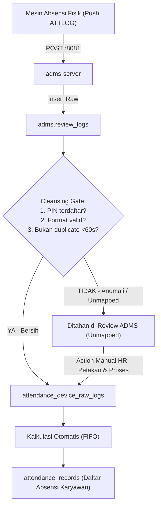

# Design Spec: Alur Sinkronisasi Hybrid ADMS ke Daftar Absensi & Pembersihan Data

## 1. Summary & Problem Statement
Sistem GAJIANICH saat ini telah memiliki receiver ADMS yang menerima push data presensi dari mesin fisik ke `adms.review_logs`. 
Pengguna menghendaki alur kerja **Hybrid**:
1. **Otomatis Masuk Absensi (Default)**:
   - Data scan dari mesin ADMS secara otomatis langsung masuk ke daftar absensi karyawan (`attendance_records` melalui `attendance_device_raw_logs` & kalkulasi FIFO).
   - Karyawan dan HR tidak perlu lagi melakukan penarikan manual melalui kabel LAN port 4370.
2. **Pembersihan & Validasi Data (Data Cleansing)**:
   - Sebelum log masuk ke absensi karyawan, data harus **bersih dan clear**:
     - Memastikan PIN cocok dengan karyawan aktif di kelompok organisasi yang sama (`employee_id` valid).
     - Menghilangkan *accidental double scan* (scan berulang dalam waktu sangat dekat/jeda detik).
     - Menentukan Jam Masuk terawal dan Jam Pulang terakhir (FIFO).
   - Log yang tidak memenuhi syarat (misal PIN belum terdaftar) ditahan di `adms.review_logs` sebagai log *unmapped*, sehingga tidak mengotori absensi utama.
3. **Review Manual & Action HR**:
   - Jika ada kasus karyawan sudah scan tetapi tidak muncul di absensi (karena PIN belum terdaftar di master data), HR dapat meninjau log tersebut di menu Review ADMS dan melakukan tindakan manual: **Petakan PIN ke Karyawan** dan **Proses Log ke Presensi**.

---

## 2. Goals & Non-Goals

### Goals:
1. **Pipeline Otomatis Masuk Presensi**:
   - Log ADMS yang terverifikasi (`employee_id` terpetakan) otomatis dimasukkan ke `attendance_device_raw_logs` dan memicu kalkulasi absensi harian (`attendanceRecords`).
2. **Pembersihan Data Otomatis**:
   - Deduplikasi scan dengan jeda < 60 detik (debouncing scan fisik berulang).
   - Validasi tanggal dan format timestamp.
3. **Kalkulasi Multi-Scan Harian (FIFO)**:
   - Log terawal sebagai Scan Masuk (`scan_in`).
   - Log terakhir sebagai Scan Pulang (`scan_out`).
   - Jumlah scan harian tercatat lengkap (`rawPunchesCount`).
4. **Action Manual HR untuk Unmapped Logs**:
   - Endpoint & UI untuk memetakan PIN anomali ke karyawan tertentu.
   - Endpoint & UI untuk memproses/mengevaluasi ulang log unmapped terpilih langsung ke presensi utama tanpa duplikasi.

### Non-Goals:
- Menghapus riwayat audit trail di `adms.review_logs` (riwayat raw log fisik tetap tersimpan permanen untuk audit).
- Mengubah kalkulasi payroll langsung tanpa melalui `attendance_records`.

---

## 3. Data Model & Architecture



### Cleansing & Ingestion Rules:
1. **Debounce Interval**: Scan dengan PIN sama, Device sama, dalam rentang waktu < 60 detik diabaikan dari penambahan raw log ganda.
2. **Atomic Ingestion**: Menggunakan `ingestion_key` (MD5 hash) pada `attendance_device_raw_logs` dengan `ON CONFLICT DO NOTHING`.
3. **Reactive Attendance Calculation**: Saat raw log baru masuk, fungsi `mergeAttendanceScans` memperbarui `attendance_records` untuk tanggal tersebut:
   - Jika belum ada log: dijadikan `scan_in`.
   - Jika sudah ada `scan_in` dan scan baru lebih malam: dijadikan `scan_out`.
   - Jika scan baru lebih pagi dari `scan_in` lama: `scan_in` diperbarui ke yang lebih pagi, dan scan sebelumnya menjadi intermediate/out.

---

## 4. API Specifications

### 1. `POST /api/v1/attendance/devices/adms/sync-to-attendance`
- **Tujuan**: Memproses dan memindahkan log ADMS yang bersih pada rentang tanggal tertentu langsung ke presensi utama (jika diperlukan sinkronisasi ulang).
- **Akses**: `SuperAdmin`, `ITAdmin`, `attendance.manage`.
- **Payload**:
  ```json
  {
    "startDate": "2026-10-01",
    "endDate": "2026-10-30",
    "deviceId": 1
  }
  ```
- **Response**: `{ success: true, processedCount: 15, updatedRecords: 12 }`

### 2. `POST /api/v1/attendance/devices/adms/resolve-unmapped`
- **Tujuan**: Tindakan manual HR jika karyawan scan tapi belum terdaftar (PIN belum dipetakan).
- **Akses**: `SuperAdmin`, `ITAdmin`, `attendance.manage`.
- **Payload**:
  ```json
  {
    "pin": "0045",
    "employeeId": 12,
    "processLogs": true
  }
  ```
- **Response**: `{ success: true, message: "PIN 0045 berhasil dipetakan ke Budi Santoso dan 3 log absensi berhasil diproses ke presensi." }`

---

## 5. UI/UX Specifications
1. **Review ADMS Page (`/dashboard/attendance/adms`)**:
   - Filter cepat tab Log Review: **"Log Belum Dipetakan (Unmapped)"**.
   - Pada baris log unmapped: tombol aksi cepat **"Petakan ke Karyawan"**.
   - Modal cepat untuk memilih nama karyawan dan opsi *"Langsung proses log ini ke daftar absensi"*.
   - Tombol sinkronisasi *"Sinkronkan Log ADMS ke Presensi"* dengan feedback jumlah log bersih yang diproses.
2. **Daftar Absensi Karyawan (`/dashboard/attendance`)**:
   - Menampilkan status scan masuk (terawal) dan scan pulang (terakhir).
   - Badge kecil menampilkan total scan (misal `3x scan`).

