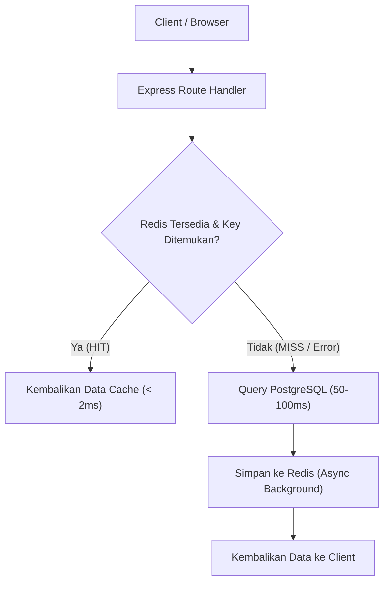

# Design Spec: Redis Caching Layer for GAJIANICH

> **Superseded** oleh [2026-11-04-performance-caching-design.md](./2026-11-04-performance-caching-design.md).

## 1. Summary & Problem Statement
Aplikasi GAJIANICH saat ini melakukan hit langsung ke basis data PostgreSQL untuk setiap permintaan API, termasuk:
- Pengecekan sesi pengguna dan role permissions pada setiap transisi halaman.
- Perhitungan agregasi metrik KPI absensi (hadir, terlambat, izin, sakit, cuti, absen).
- Resolusi pemetaan PIN mesin absensi ADMS ke `employee_id`.

Seiring bertambahnya data historis absensi dan banyaknya log push dari mesin ADMS, query agregasi dan autentikasi berulang membebani database dan meningkatkan Time-to-First-Byte (TTFB) API (150ms - 500ms).

Integrasi **Redis 7 (In-Memory)** sebagai caching layer dirancang untuk:
1. Menyimpan data sesi dan profil user login dengan TTL terkelola.
2. Menyimpan rekap KPI absensi harian secara in-memory dengan auto-invalidation saat ada presensi baru masuk.
3. Mempercepat lookup PIN karyawan untuk ADMS ingest tanpa menyentuh disk I/O PostgreSQL.

---

## 2. Goals & Non-Goals

### Goals
- Menyediakan Redis service yang ringan (`mem_limit: 128m`) pada `compose.lan.yml` dan `compose.prod.yml`.
- Mengimplementasikan modul `redisClient.ts` yang resilient dengan fallback transparan jika Redis tidak tersedia (graceful degradation: jika Redis mati/down, request tetap berjalan normal langsung ke PostgreSQL tanpa crash).
- Cache data sesi pengguna (`GET /api/v1/auth/session`) dengan TTL 15 menit.
- Cache data ringkasan KPI absensi harian (`/api/v1/attendance/mobile/summary`) dengan TTL 60 detik atau event invalidation saat ada scan/presensi baru.
- Peningkatan performa TTFB API target: **< 30 ms** untuk data yang ter-cache.

### Non-Goals
- Tidak menggantikan PostgreSQL sebagai persistent primary store (Redis murni in-memory cache).
- Tidak menggunakan Redis cluster/sentinel yang kompleks (cukup standalone instance dengan persistensi RDB berkala).
- Tidak meng-cache data transaksi sensitif keuangan atau mutasi mutlak yang belum terverifikasi.

---

## 3. Data Model & Cache Key Taxonomy

| Kategori Cache | Pola Key | TTL | Strategi Invalidasi |
| :--- | :--- | :--- | :--- |
| **User Session** | `session:user:{userId}` | 15 menit | Saat user logout, ganti password, atau update profile |
| **KPI Summary** | `attendance:summary:{orgId}:{date}` | 60 detik | Auto-expired atau di-invalidate saat log absensi baru tersimpan |
| **ADMS PIN Map** | `adms:pin:{groupId}:{pin}` | 1 jam | Saat data karyawan diupdate atau PIN dimutasi |

---

## 4. Resilient Architecture & Fallback (Graceful Degradation)

Jika koneksi Redis mengalami gangguan atau timeout:
- Sistem **TIDAK BOLEH** melempar 500 Error ke user.
- Logger mencatat warning level.
- Permintaan otomatis diteruskan ke database PostgreSQL utama.

---

## 5. Security & Isolation
- Port Redis `6379` **TIDAK DIEKSPOS** ke publik atau host network luar; hanya dapat diakses di dalam Docker bridge network internal antar kontainer backend.
- Opsional: Password proteksi via environment variable `REDIS_PASSWORD` jika diperlukan.

