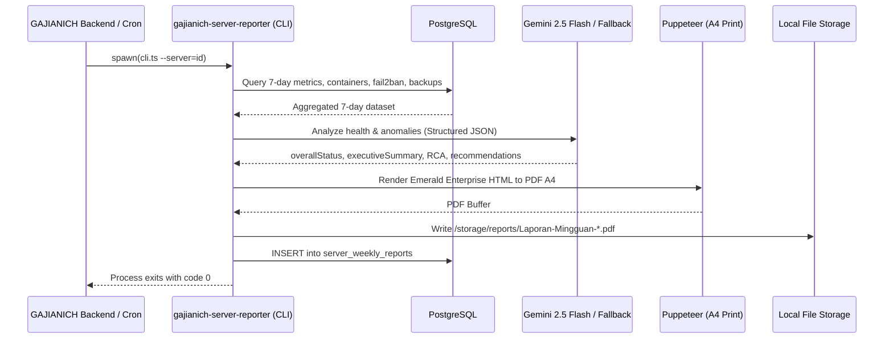

# DESIGN SPEC: GAJIANICH Infrastructure Weekly Health & Security Audit Reporting

**Project:** GAJIANICH Core & Infrastructure  
**Feature:** Server Weekly Health & Security Audit Reporting (Decoupled Hub-and-Spoke with Gemini AI & PDF Generation)  
**Date:** 2026-11-23  
**Status:** In Review (Spec-Driven Development)  
**Target Environment:** Development Server (`fastpec@192.168.10.212`)  
**Reference Document:** `docs/specs/PRD-SERVER-WEEKLY-REPORT-AUDIT.md` (Document ID: `PRD-INFRA-REPORT-001`)

---

## 1. Summary & Problem Statement

Pemantauan server infrastruktur GAJIANICH saat ini telah memiliki streaming telemetri *real-time* ke dashboard Server360. Namun, terdapat celah operasional:
1. **Tidak Adanya Laporan Resmi Berkala (A4 PDF)**: Manajemen, CTO, dan tim audit eksternal membutuhkan ringkasan eksekutif mingguan yang formal dan siap cetak mengenai status ketersediaan (SLA), kapasitas storage/RAM, serta keamanan.
2. **Keterbatasan Analisis Manual**: Menghubungkan log error aplikasi, restart Docker, dan insiden keamanan (brute force SSH, Fail2Ban) memakan waktu audit manual berjam-jam setiap pekan.
3. **Pencampuran Modul (Coupling Risk)**: Modul pelaporan berat (Chromium, Puppeteer, AI SDK) tidak boleh dipasang pada agen klien (`gajianich-server-agent`), melainkan harus berjalan terisolasi di server pusat.

Solusi yang dirancang mengadopsi arsitektur **Decoupled Hub-and-Spoke**:
* **`gajianich-server-agent`**: Klien ultra-ringan dengan dukungan *self-update* jarak jauh (`scripts/update.sh` & remote action `update`).
* **`gajianich-server-reporter`**: Modul pemroses independen *ephemeral* di `/home/fastpec/code/gajianich-server-reporter` yang mengagregasi data 7 hari dari PostgreSQL, memproses analisis cerdas via Google Gemini Free Tier (`gemini-2.5-flash`) dengan fallback lokal berbasis aturan, merender dokumen PDF A4 *Emerald Enterprise*, dan mencatat metadata ke database.
* **GAJIANICH Core Backend**: Schema tabel `server_weekly_reports` (Drizzle ORM), endpoint REST API manajemen & unduh laporan, serta trigger on-demand via asynchronous child process.
* **GAJIANICH Web Dashboard**: Halaman dedicated `/dashboard/infrastructure/reports` dengan KPI grid interaktif, filter toolbar, tabel riwayat laporan, modal trigger on-demand, dan aksi unduh PDF.

---

## 2. Goals & Non-Goals

### Goals
* **Pemisahan Modul Ketat**: `gajianich-server-agent` bebas dari Puppeteer, Chromium, dan `@google/genai`.
* **Agregasi Metrik 7 Hari**: Mengambil data CPU, RAM, Disk growth, Network throughput, Docker container restarts, Fail2Ban, failed SSH logins, SSL expiry, dan DB backups dari PostgreSQL.
* **Analisis Cerdas & Tangguh**: Analisis otomatis dengan `gemini-2.5-flash` terstruktur (`overallStatus`, `executiveSummary`, `incidentRca`, `recommendations`), dilengkapi *Rule-Based Engine Fallback* jika API key kosong/limit/gagal.
* **Format Laporan Standar Eksekutif**: PDF A4 Portrait dengan styling *Emerald Enterprise*, header/footer berulang, penomoran halaman otomatis (*Halaman X dari Y*), dan penanganan page-break rapi.
* **Mekanisme Pemicu Ganda**: Scheduler berkala (Cron setiap Senin 06:00 WIB) dan On-Demand (CLI & REST API/Web UI).
* **Remote Agent Update**: Mendukung remote command `update` pada agen untuk mengeksekusi `scripts/update.sh`.
* **Frontend UI Enterprise**: Halaman `/dashboard/infrastructure/reports` mematuhi Master Desain Baku GAJIANICH (PageHeader emerald, KPI Cards interaktif, FilterToolbar, TableShell, dan RowActionButton).

### Non-Goals (Hal yang Eksplisit DILARANG / TIDAK Dikerjakan)
* **DILARANG MENGGUNAKAN DUMMY DATA**: Seluruh data telemetri, metrik, layanan kontainer, dan backup diekstrak langsung dari data riil database PostgreSQL (`server_metric_samples`, `servers`, `db_backups`/`database_backups`).
* **DILARANG KERAS memasang engine Chromium, Puppeteer, AI SDK, atau PDF generator pada `gajianich-server-agent`**. Agen klien murni dan HANYA bertugas mengirimkan data telemetri berupa JSON ke server pusat. Seluruh proses agregasi, analisis AI, dan generator PDF dilakukan 100% di server pusat/utama oleh modul `gajianich-server-reporter`.
* **TIDAK mengubah** konfigurasi server produksi saat ini (`/home/cmc/app/svc/gajianich`). Seluruh eksekusi dan uji coba dilakukan di server development.
* **TIDAK menggantikan** dashboard telemetri *real-time* Server360; laporan mingguan bertindak sebagai pelengkap audit berkala.

---

## 3. Data Model & Schema Diffs (Drizzle ORM)

File target skema: `backend/src/db/schema/infrastructure.ts`

```typescript
export const serverWeeklyReports = pgTable('server_weekly_reports', {
  id: bigint('id', { mode: 'number' }).generatedAlwaysAsIdentity().primaryKey(),
  serverId: bigint('server_id', { mode: 'number' })
    .references(() => servers.id, { onDelete: 'cascade' })
    .notNull(),
  periodWeek: varchar('period_week', { length: 20 }).notNull(), // e.g. '2026-W47'
  startDate: date('start_date').notNull(),
  endDate: date('end_date').notNull(),
  status: varchar('status', { length: 30 }).default('NORMAL').notNull(), // 'NORMAL' | 'WARNING' | 'CRITICAL'
  executiveSummary: text('executive_summary'),
  incidentRca: text('incident_rca'),
  recommendations: jsonb('recommendations').$type<Array<{ priority: 'TINGGI' | 'SEDANG' | 'RENDAH'; title: string; action: string }>>().default([]).notNull(),
  pdfFileName: varchar('pdf_file_name', { length: 255 }).notNull(),
  pdfFilePath: varchar('pdf_file_path', { length: 500 }).notNull(),
  fileSizeBytes: bigint('file_size_bytes', { mode: 'number' }).default(0).notNull(),
  generatedBy: varchar('generated_by', { length: 50 }).default('GEMINI_AI_SCHEDULER').notNull(),
  createdAt: timestamp('created_at').defaultNow().notNull(),
}, (table) => [
  index('idx_server_weekly_reports_server_period').on(table.serverId, table.periodWeek),
  index('idx_server_weekly_reports_created_at').on(table.createdAt),
]);
```

### Relasi & Migrasi Database
* Foreign key ke `servers.id` dengan onDelete: `cascade`.
* File migrasi Drizzle otomatis dibuat dan diverifikasi via test suite.

---

## 4. API Specifications (GAJIANICH Core Backend)

Routing file target: `backend/src/routes/infrastructureRoutes.ts`  
Controller target: `backend/src/controllers/infrastructureController.ts`

### 4.1 GET `/api/v1/infrastructure/reports`
* **Hak Akses:** `infrastructure.view` (autentikasi JWT token).
* **Query Parameters:**
  * `serverId` (opsional): filter berdasarkan ID server.
  * `status` (opsional): filter `NORMAL`, `WARNING`, `CRITICAL`.
  * `search` (opsional): pencarian kode server atau periode pekan.
  * `limit` (default: 20, max: 100), `offset` (default: 0).
* **Response (200 OK):**
```json
{
  "success": true,
  "data": [
    {
      "id": 1,
      "serverId": 1,
      "serverCode": "srv-dev-cmc",
      "serverName": "Development Server",
      "periodWeek": "2026-W47",
      "startDate": "2026-11-17",
      "endDate": "2026-11-23",
      "status": "NORMAL",
      "executiveSummary": "Infrastruktur beroperasi stabil dengan SLA 99.98%...",
      "recommendationsCount": 3,
      "pdfFileName": "Laporan-Mingguan-srv-dev-cmc-2026-W47.pdf",
      "fileSizeBytes": 245120,
      "generatedBy": "GEMINI_AI_SCHEDULER",
      "createdAt": "2026-11-23T06:00:00Z"
    }
  ],
  "pagination": { "total": 1, "limit": 20, "offset": 0 }
}
```

### 4.2 GET `/api/v1/infrastructure/reports/:id/download`
* **Hak Akses:** `infrastructure.view`.
* **Perilaku:** Memeriksa keberadaan file di `pdf_file_path`, kemudian mengirim file stream dengan header:
  * `Content-Type: application/pdf`
  * `Content-Disposition: attachment; filename="Laporan-Mingguan-srv-dev-cmc-2026-W47.pdf"`
* **Response Error:** 404 Not Found jika rekaman atau file fisik tidak ditemukan.

### 4.3 POST `/api/v1/infrastructure/reports/generate`
* **Hak Akses:** `infrastructure.manage`.
* **Request Body:** `{ "serverId": 1 }` (opsional, jika kosong men-generate semua server aktif).
* **Perilaku:** Men-spawn proses background `child_process.spawn` untuk CLI reporter, merespon segera dengan `202 Accepted`.
* **Response (202 Accepted):**
```json
{
  "success": true,
  "message": "Proses generate laporan mingguan telah dimulai di latar belakang."
}
```

---

## 5. Modul `gajianich-server-reporter` Architecture

Direktori target: `/home/fastpec/code/gajianich-server-reporter` (dan link `/mnt/Data/code/gajianich-server-reporter`)

### 5.1 Struktur Direktori Modul
```text
gajianich-server-reporter/
├── package.json
├── tsconfig.json
├── .env.example
├── src/
│   ├── index.ts                # Main entry point & scheduler
│   ├── cli.ts                  # CLI runner (npm run generate -- --server=srv-dev-cmc)
│   ├── config/
│   │   ├── db.ts               # PostgreSQL client / Drizzle connection
│   │   └── env.ts              # Load and validate environment variables (GEMINI_API_KEY, DB_URL, etc.)
│   ├── aggregator/
│   │   └── dataAggregator.ts   # 7-day metric & event extraction (FR-1)
│   ├── ai/
│   │   ├── geminiAnalyst.ts    # Gemini 2.5 Flash analysis engine (FR-2)
│   │   └── ruleBasedFallback.ts# Rule-based fallback when Gemini API unavailable
│   ├── generator/
│   │   ├── template.ts         # HTML & CSS Emerald Enterprise layout (FR-3)
│   │   └── pdfRenderer.ts      # Puppeteer headless Chromium runner
│   └── storage/
│       └── archiver.ts         # File saving to storage/reports & DB insert (FR-4)
└── tests/
    ├── aggregator.test.ts
    ├── aiAnalyst.test.ts
    └── template.test.ts
```

### 5.2 Flowchart Pipeline Eksekusi


---

## 6. Frontend Web UI: `/dashboard/infrastructure/reports`

Penerapan standar **Master Desain Baku (Emerald Enterprise / GAJIANICH)**:
1. **PageHeader**:
   - Ikon kotak emerald (`p-2 bg-emerald-600 rounded-xl text-white` dengan ikon `FileText`).
   - H1 Extrabold: "Laporan Audit Server Mingguan".
   - Subtitle: "Ringkasan berkala ketersediaan SLA, performa kapasitas hardware, dan audit keamanan server.".
   - Aksi: Tombol "Audit Sekarang" (Primary emerald, memicu Modal Pilihan Server).
2. **KpiGrid & KpiCard**:
   - Total Laporan Terbit (ikon dokumen, filter netral).
   - Status Normal (ikon hijau CheckCircle, filter status: `NORMAL`).
   - Perlu Perhatian / Warning (ikon kuning AlertTriangle, filter status: `WARNING`).
   - Kritis / Critical (ikon merah AlertOctagon, filter status: `CRITICAL`).
   - Kartu KPI dapat diklik langsung dengan visual active ring dan badge "Aktif".
3. **FilterToolbar**:
   - Search input fleksibel (mencari kode/nama server atau periode).
   - Dropdown filter Server.
   - Dropdown filter Status (Semua, Normal, Warning, Critical).
   - Tombol Reset Filter.
4. **TableShell & Aksi Baris Berbasis Ikon**:
   - Kolom: Periode Pekan, Server, Rentang Tanggal, Status (Pill Badge), Ringkasan Eksekutif, Ukuran File, Tanggal Terbit, Aksi.
   - Tombol Aksi:
     - `Download` (ikon `Download`, mengunduh berkas PDF fisik).
     - `Detail / View` (ikon `ExternalLink`, menampilkan ringkasan modal rekomendasi & RCA).
5. **No Manual Refresh Button**: Data memuat secara otomatis dan reaktif via SWR/polling.

---

## 7. Remote Agent Update (`gajianich-server-agent`)

1. **`scripts/update.sh`**:
   - Skrip bash idempoten di root `gajianich-server-agent/`.
   - Mengambil versi terbaru dari Git, menjalankan `npm install --omit=dev`, build TypeScript (`npm run build`), dan me-restart container/service secara graceful.
2. **`src/index.ts` Remote Command Handler**:
   - Memperluas tipe perintah remote: `actionType: 'restart' | 'reload' | 'logs' | 'ping' | 'update'`.
   - Jika `actionType === 'update'`, eksekusi `bash scripts/update.sh` dan tangkap output log.
   - Laporkan hasil (`SUCCESS` / `FAILED` dengan `outputText`) ke tabel `server_remote_commands`.

---

## 8. Security & Integrity

* **Isolasi Kredensial**: `GEMINI_API_KEY` tidak pernah terekspos ke klien web maupun `server-agent`.
* **Otorisasi RBAC**: Endpoint laporan dilindungi permission `infrastructure.view` dan trigger manual `infrastructure.manage`.
* **Path Traversal Protection**: Endpoint download memvalidasi ID laporan dari database dan memastikan path file berada di dalam direktori penyimpanan yang diizinkan.
* **Puppeteer Sandbox Safety**: Flags headless Chromium dikonfigurasi aman: `--no-sandbox`, `--disable-setuid-sandbox`, `--disable-dev-shm-usage`.
